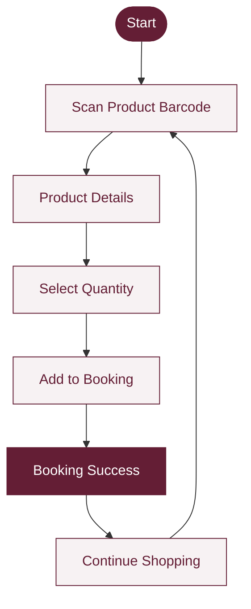
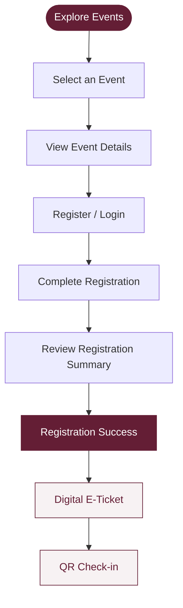

# ✦ EVENT BOOKING
### PT DUTA ABADI PRIMANTARA — DIGITAL EVENT & BOOKING MANAGEMENT SYSTEM

<p align="center">
  <strong>A Modern Multi-Page Event Booking Experience</strong><br>
  Designed with a refined Burgundy & White visual identity.
</p>

<p align="center">
  
  
  
  
</p>

---

## ◈ Project Overview

**Event Booking** is a web-based event registration and product booking prototype developed for **PT Duta Abadi Primantara (PT DAP)**.

This project transforms the original single-page application into a structured multi-page web experience while preserving its original design language, content, functionality, and interactions.

Built around a sophisticated **Burgundy & White** identity, the application brings together event discovery, participant registration, digital ticketing, QR-based check-in, barcode product scanning, and booking management in one integrated experience.

The latest version introduces an animated **Swirl Background** on the Home Screen, creating a more dynamic and immersive first impression without compromising usability.

> **One platform. Multiple experiences. A more connected event journey.**

## ✦ Highlights

| Feature | Description |
|---|---|
| Multi-Page Architecture | Independent HTML pages with shared JavaScript modules |
| Event Discovery | Explore, search, and filter available events |
| Digital Registration | Structured participant registration workflow |
| E-Ticket & QR Code | Digital ticket generation and check-in |
| QR Check-in | Simulated event attendance verification |
| Barcode Product Scanner | Product access through barcode scanning |
| Product Booking | Quantity selection and booking confirmation |
| Booking Management | Booking history and detailed transaction information |
| User Account | Profile, notifications, and security settings |
| Animated Home Screen | Integrated Swirl visual background |
| Responsive Interface | Layout adjustments for different screen sizes |
| Local Data Storage | Prototype data managed through browser localStorage |

## ◈ Application Experience

The platform is organized into interconnected experiences:

**01 — Discover**
- Home Screen
- Explore Events
- Event Details

**02 — Participate**
- Account Registration
- Login
- Event Registration
- Registration Summary
- Registration Success

**03 — Digital Ticketing**
- Ticket List
- Ticket Details
- QR Check-in
- Check-in Success

**04 — Product Booking**
- Barcode Scanner
- Product Details
- Quantity Management
- Booking Success
- Booking History
- Booking Details

**05 — Account Management**
- User Profile
- Notifications
- Privacy & Security
- Change Password

## ◈ Booking Workflow

The revised product booking process follows a barcode-first approach.



**Booking rules:**
- Products can only be accessed through barcode scanning.
- Quantity is controlled using increment and decrement buttons.
- Maximum quantity per booking is 5.
- Add to Booking immediately opens the Booking Success page.
- Continue Shopping returns users to the barcode scanner.

There is no publicly accessible product catalog in this workflow.

## ◈ Event Registration Workflow



## ✦ Technical Architecture

The application uses a lightweight front-end architecture without a bundler or mandatory package installation.

| Technology | Implementation |
|---|---|
| HTML5 | Multi-page application structure |
| CSS3 | Styling, layout, transitions, and animations |
| JavaScript | Application logic and interactions |
| localStorage | Prototype data persistence |
| QR Code | Digital ticket and check-in simulation |
| SVG | Icons and animated visual elements |
| Swirl Effect | Animated Home Screen background |

**Architecture principles:**
- Modular JavaScript organization.
- Shared application state.
- Centralized route definitions.
- Reusable components and page modules.
- Consistent stylesheet loading order.
- Classic JavaScript scripts without ES module dependencies.

## ◈ Project Structure

```text
Event-Booking/
│
├── index.html
├── home.html
├── events.html
├── event-detail.html
│
├── login.html
├── register.html
│
├── register-event.html
├── register-event-summary.html
├── registration-success.html
│
├── tickets.html
├── ticket-detail.html
├── check-in.html
│
├── scanner.html
├── product-detail.html
├── booking-success.html
├── booking-history.html
├── booking-detail.html
│
├── profile.html
├── notifications.html
├── privacy-security.html
├── change-password.html
│
├── 404.html
│
└── assets/
    ├── css/
    │   ├── base.css
    │   ├── header.css
    │   ├── buttons.css
    │   ├── layout.css
    │   ├── home.css
    │   ├── events.css
    │   ├── auth.css
    │   ├── registration.css
    │   ├── tickets.css
    │   ├── booking.css
    │   ├── account.css
    │   ├── history.css
    │   ├── footer.css
    │   ├── overlays.css
    │   ├── responsive.css
    │   ├── fixes.css
    │   ├── motion.css
    │   └── swirl.css
    │
    ├── js/
    │   ├── core/
    │   ├── shared/
    │   ├── pages/
    │   └── effects/
    │       ├── swirl.js
    │       ├── motion.js
    │       └── fx-boot.js
    │
    ├── img/
    └── fonts/
```

## ✦ Animated Swirl Experience

The Home Screen features an integrated animated Swirl background adapted from the separately supplied Background project.

**Visual implementation:**
- Original SVG paths and gradient composition.
- Original turbulence filters and animation keyframes.
- Original per-frame motion calculations.
- Burgundy-inspired interface combined with the original Swirl visual.
- Dedicated CSS namespace using `swirl-` prefixes.
- Layered behind the hero content.
- Non-interactive background layer.
- Animation pauses when the hero is not visible or the browser tab is hidden.
- Reduced-motion support for accessibility.

A subtle dark overlay improves the readability of white hero text while preserving the original Swirl animation.

The visual effect is intentionally limited to the Home Screen.

## ◈ Running Locally

No build process and no `npm install` are required.

**Option 1 — Python HTTP Server (Recommended)**

```bash
python3 -m http.server 8000
```

Open:

```text
http://localhost:8000/
```

**Option 2 — VS Code Live Server**

1. Open the project folder in VS Code.
2. Install the Live Server extension.
3. Right-click `index.html`.
4. Select **Open with Live Server**.

**Option 3 — Direct File Access**

Open `index.html` or `home.html` directly in a Chromium-based browser.

For consistent localStorage behavior across pages, using a local HTTP server is recommended.

## ✦ Demo Access

| Item | Details |
|---|---|
| Demo Email | siraj.fatwa@example.com |
| Demo Password | Demo@2026 |
| Storage | Browser localStorage |
| Storage Key | `ecbs.v1` |

**Demo Tools**

The Demo Tools control in the footer allows users to:
- Load sample registrations.
- Generate two sample bookings.
- Populate four sample notifications.
- Reset prototype data.

All demonstration data is stored locally in the browser.

> Demo credentials are intended for local prototype testing only. Do not use real personal or production credentials.

## ◈ Important Implementation Notes

**Multi-Page Navigation**

The original SPA routing structure has been adapted to independent HTML pages. Existing route references and legacy links are mapped to the corresponding pages.

**Authentication**

Protected pages redirect unauthenticated users to Login and preserve their intended destination. Users who are already authenticated are redirected to Home when accessing Login or Registration.

**Shared State**

Application data is managed through the shared JavaScript core and browser localStorage.

**Script Execution Order**

Each page loads its stylesheets and shared JavaScript dependencies in a consistent order. Page-specific scripts are loaded before the application boot process, followed by the original motion effects.

## ✦ Adding a New Page

1. Register the new page in `PAGES` inside `assets/js/core/routes.js`.
2. Create the corresponding view in `assets/js/pages/`.
3. Define the page using the existing `V.<key> = (id, qs) => '...html...'` pattern.
4. Duplicate an existing HTML page and update its `data-page`, document title, and page-specific script.
5. Verify navigation, authentication, responsive behavior, and localStorage integration.

## ◈ Design Identity

| Element | Specification |
|---|---|
| Primary Color | Burgundy `#641E35` |
| Secondary Color | White `#FFFFFF` |
| Surface Color | `#F7F2F3` |
| Text Color | `#252525` |
| Success | `#16A34A` |
| Error | `#B4233C` |
| Typography | Plus Jakarta Sans |

The visual direction emphasizes clarity, consistency, elegance, and a professional corporate experience.

## ✦ Quality & Cross-Check

The project includes `CROSS-CHECK-REPORT.md` to document the implementation review.

Key verification areas:
- Page and route consistency.
- Navigation between HTML pages.
- Authentication and protected routes.
- Registration and ticket workflows.
- QR and barcode simulation.
- Booking quantity restrictions.
- Booking history and detail views.
- Responsive layouts.
- CSS and JavaScript loading order.
- Swirl animation behavior.
- Legacy route compatibility.

## ◈ Project Scope & Limitations

This is a front-end prototype intended to demonstrate application workflows and interface behavior.

- Data is stored in browser localStorage.
- Authentication is simulated locally.
- Barcode scanning uses a camera simulation.
- QR check-in is a prototype workflow.
- No production backend or live transaction infrastructure is implied.

## ✦ Development Philosophy

This project reflects an approach to Information Systems development that combines business process understanding, structured application architecture, interface design, and practical implementation.

The objective is not simply to create individual web pages, but to deliver a connected digital experience in which every interaction supports a clearly defined user journey.

---

<p align="center">
  <strong>EVENT BOOKING — PT DUTA ABADI PRIMANTARA</strong><br>
  <sub>Designed with purpose. Structured with precision. Built for a connected experience.</sub>
</p>

<p align="center">
  
</p>
